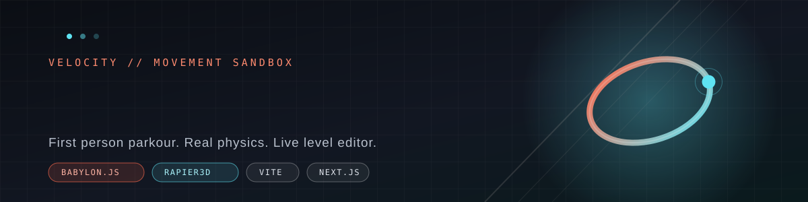
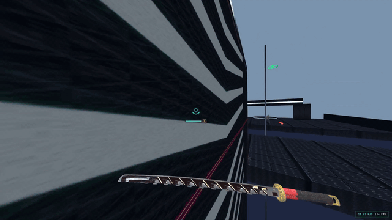
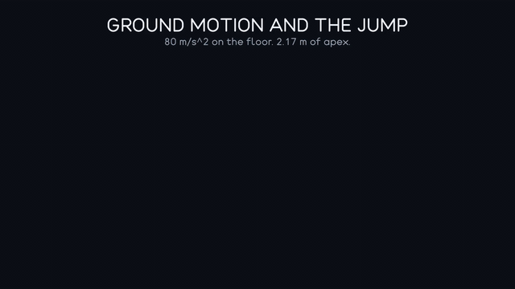
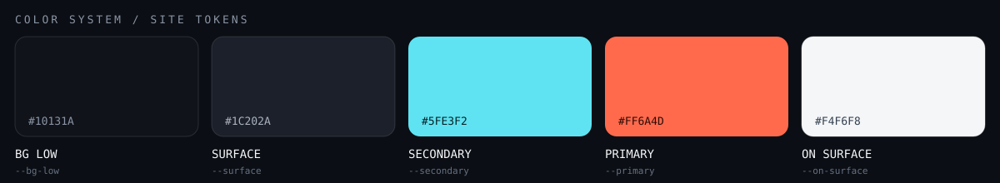

<div align="center">
  
  <br>

  <a href="https://play-velocity.pages.dev/"></a>
  <a href="https://velocity-game.pages.dev/"></a>
  
  
  

  <h2>Fast movement. Committed grapple. Sharp combat. Live editing.</h2>
  <p>
    Velocity is a Babylon.js + Rapier3D first person parkour sandbox built around fast,
    arcade-style traversal: a katana viewmodel, dash, slides, wall running, sensory slow motion,
    and a high-speed grappling hook. Eight authored levels, homing shuriken, and a live editor ship with it.
  </p>

  <p>
    <a href="https://play-velocity.pages.dev/"><strong>Play the game</strong></a>
    · <a href="https://velocity-game.pages.dev/"><strong>Open the showcase</strong></a>
    · <a href="#source-map"><strong>Browse the source</strong></a>
  </p>
</div>

## See it move

Animations below are generated from the in-repo gameplay captures and physics explainer.

<table>
  <tr>
    <td width="50%" valign="top">
      <a href="docs/gameplay.gif"></a>
      <br>
      <strong>Traversal loop</strong>
      <br>
      <sub>Level 4 to 8 capture, from <code>website/assets/video-source/levels4-8.mp4</code></sub>
    </td>
    <td width="50%" valign="top">
      <a href="docs/grapple.gif"></a>
      <br>
      <strong>Grapple lines</strong>
      <br>
      <sub>Level 1 to 4 capture, from <code>website/assets/video-source/menu_levels1-4.mp4</code></sub>
    </td>
  </tr>
  <tr>
    <td colspan="2" valign="top">
      <a href="docs/physics.gif"></a>
      <br>
      <strong>Physics explainer</strong>
      <br>
      <sub>Rendered from <a href="manim/physics_explainer.py"><code>manim/physics_explainer.py</code></a></sub>
    </td>
  </tr>
</table>

## Color system

The showcase uses a dark blue surface with a coral primary and a cyan secondary. The same palette drives the HUD, level picker, and card system.

<div align="center">
  
</div>

Tokens live in two places:

- Showcase theme: [`website/app/globals.css`](website/app/globals.css)
- Game theme: [`src/design-system.css`](src/design-system.css) and [`src/ui/theme.ts`](src/ui/theme.ts)

## Play routes

| Route | What it opens |
|---|---|
| [Level picker](https://play-velocity.pages.dev/) | Root URL with all eight levels and the original course |
| [Direct level](https://play-velocity.pages.dev/?level=level3) | Loads `level3` straight into the game |
| [Original course](https://play-velocity.pages.dev/?intro=1) | Keeps the hand authored opening level and cinematic |
| [Campaign chain](https://play-velocity.pages.dev/?level=level1&campaign=1) | Chains finish rings across all eight levels |
| [Level editor](https://play-velocity.pages.dev/editor.html) | Places geometry, colliders, spawns, and triggers in the browser |

Level data is read from [`levels/`](levels/) at runtime. Level order and campaign rules live in [`src/world/levels/campaign.ts`](src/world/levels/campaign.ts).

## Controls

| Input | Action |
|---|---|
| <kbd>W</kbd> <kbd>A</kbd> <kbd>S</kbd> <kbd>D</kbd> | Move |
| Mouse | Look, click the canvas to capture the pointer |
| <kbd>Space</kbd> | Jump, skip the intro |
| <kbd>Shift</kbd> on ground | Dash toward the crosshair when the meter is full |
| <kbd>Shift</kbd> in air | Hold for sensory slow motion, release for a forward dash |
| <kbd>A</kbd> / <kbd>D</kbd> in sensory | Short sideways evasive dashes |
| <kbd>Ctrl</kbd> | Hold to slide, tap after <kbd>W</kbd> is already held |
| Left mouse | Katana slash, first <code>0.18s</code> is the parry window |
| Right mouse | Fire the grapple at the locked ring |
| <kbd>Q</kbd> | Throw a homing shuriken |
| <kbd>R</kbd> | Instant reset, works without pointer lock |
| <kbd>Esc</kbd> | Release the pointer |

Hold <kbd>W</kbd> first, then tap <kbd>Ctrl</kbd>. <kbd>Ctrl</kbd> + <kbd>W</kbd> closes the browser tab.

## Systems

| System | Source | What it does |
|---|---|---|
| Bootstrap | [`src/app/main.ts`](src/app/main.ts) | Level picker, query params, game startup |
| Game loop | [`src/app/Game.ts`](src/app/Game.ts) | Scene wiring, render loop, HUD updates |
| Input | [`src/input/InputManager.ts`](src/input/InputManager.ts) | Raw pointer lock look, keyboard state, reset and throw hooks |
| Movement | [`src/world/FirstPersonController.ts`](src/world/FirstPersonController.ts) | Run, jump, dash, slide, mantle, wall run, sensory boost |
| Grapple | [`src/world/Grappler.ts`](src/world/Grappler.ts) | Cone targeting, line of sight, anchor visuals |
| Katana | [`src/world/KatanaViewmodel.ts`](src/world/KatanaViewmodel.ts) | Swing animation, parry timing, blade pose |
| Slash trail | [`src/world/SlashTrail.ts`](src/world/SlashTrail.ts) | Procedural ribbon and additive shader |
| Combat | [`src/combat/CombatSystem.ts`](src/combat/CombatSystem.ts) | Melee kills, hit stop, sparks, slice arcs |
| Shuriken | [`src/combat/ShurikenSystem.ts`](src/combat/ShurikenSystem.ts) | Homing throw, energy, enemy stun |
| Projectiles | [`src/combat/ProjectileManager.ts`](src/combat/ProjectileManager.ts) | Guard bolts, parry deflection, wall hits |
| Enemies | [`src/entities/`](src/entities/) | Pistol, SMG, sword elite, and mech guards |
| Editor | [`src/editor/editor.ts`](src/editor/editor.ts) | Live level placement and JSON export |
| Levels | [`levels/`](levels/) | Eight exported level JSON files |
| Models | [`public/models/`](public/models/) | Katana, shuriken, and enemy GLB files |
| Sounds | [`public/sounds/`](public/sounds/) | Generated and authored SFX |

### Why the movement feels fast

[`src/config/movement.ts`](src/config/movement.ts) holds the numbers that define the feel. Base run speed is <code>10 m/s</code>, with <code>0.3s</code> coyote time, a <code>0.12s</code> jump grace window, and momentum preserving air control. Gravity is <code>20.32 m/s²</code> and increases while falling.

- Dash runs at <code>24 m/s</code> for <code>0.2s</code> with a vertical dead zone, so a slightly tilted view still gives a flat dash.
- Sensory boost slows time to <code>20%</code> for up to <code>3s</code>, then releases into a forward dash.
- Slide bursts to <code>17 m/s</code>, carves through turns, and keeps momentum into slide hops.
- Wall run lasts up to <code>2s</code> with camera roll and a tangent kick on jump.
- FOV widens with speed, and the camera rolls into slides and wall runs.

<details>
<summary><strong>Grapple model</strong></summary>

A ring qualifies when it is within <code>34m</code>, inside a <code>0.62 rad</code> cone around the crosshair, and has a clear line to the player. The line of sight check uses a sphere cast with radius <code>0.4</code>, so a ring slightly off center still locks on.

The pull cancels downward velocity, keeps horizontal speed, disables gravity, and ramps to <code>34 m/s</code>. Jump and dash boost the pull instead of cancelling it. Near the anchor, the hook releases and applies a solved ballistic arc over the ledge. Anchors can carry a <code>landing</code> hint for reliable arrival.

All tuning lives in [`src/config/grapple.ts`](src/config/grapple.ts).

</details>

<details>
<summary><strong>Katana, parry, and shuriken</strong></summary>

Left mouse swings for <code>0.2s</code> with a <code>0.22s</code> cooldown. During the swing, the steel hides and a procedural light ribbon leaves the blade tip. A guard within <code>3.5m</code> and inside a forward cone dies on the hit frame, triggering hit stop, flash, FOV punch, shake, sparks, and a crescent arc.

The first <code>0.18s</code> of the swing is a parry window. An incoming bolt is reflected at <code>1.75×</code> speed, turns cyan, and can kill a guard. <kbd>Q</kbd> throws a homing shuriken that uses energy and can stun enemies for the approved grapple execution flow.

Timing and ranges live in [`src/config/combat.ts`](src/config/combat.ts).

</details>

<details>
<summary><strong>Level pipeline</strong></summary>

The root URL opens [`src/ui/LevelSelect.ts`](src/ui/LevelSelect.ts), which scans [`levels/`](levels/) and browser saved edits. `?level=name` loads one level, `?intro=1` loads the original course, and `?campaign=1` chains finish rings. Browser saves can override disk copies, while the finish ring is restored from disk when needed.

The Vite build copies authored JSON into `dist/levels` through [`vite.config.ts`](vite.config.ts), so deployed levels load from `/levels/*.json`.

</details>

## Showcase site

The showcase is a static Next.js export deployed to Cloudflare Pages.

| Piece | Source |
|---|---|
| Page composition | [`website/app/page.tsx`](website/app/page.tsx) |
| Scroll provider | [`website/components/ScrollProvider.tsx`](website/components/ScrollProvider.tsx) |
| Scroll driven physics video | [`website/components/VideoStory.tsx`](website/components/VideoStory.tsx) |
| Gameplay reels | [`website/components/RunReel.tsx`](website/components/RunReel.tsx) |
| System grid | [`website/components/StackedCards.tsx`](website/components/StackedCards.tsx) |
| Live URL config | [`website/lib/site.ts`](website/lib/site.ts) |
| Static export config | [`website/next.config.ts`](website/next.config.ts) |
| Environment example | [`website/.env.example`](website/.env.example) |

Every Play CTA reads `site.gameUrl` from [`website/lib/site.ts`](website/lib/site.ts) and points to the deployed game. `NEXT_PUBLIC_GAME_URL` and `NEXT_PUBLIC_SITE_URL` can override the defaults at build time.

## Run locally

Game:

```bash
npm install
npm run dev
```

Showcase:

```bash
cd website
npm install
npm run dev
```

Static export:

```bash
cd website
npm run build
```

## Verify

```bash
npm run typecheck
npm run build
```

## Deployment

- Game: https://play-velocity.pages.dev/
- Showcase: https://velocity-game.pages.dev/

The game is a Vite build of `dist/`. The showcase is a Next.js static export from `website/out`.

## Credits

Built by Frqme. Physics by Rapier3D, rendering by Babylon.js, showcase by Next.js, and the physics explainer by Manim.
